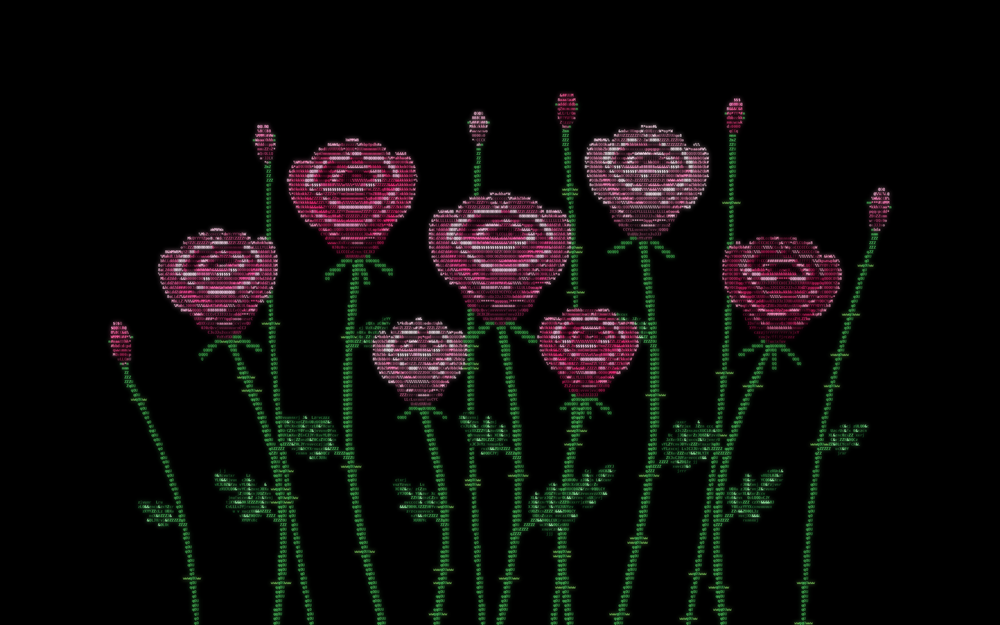
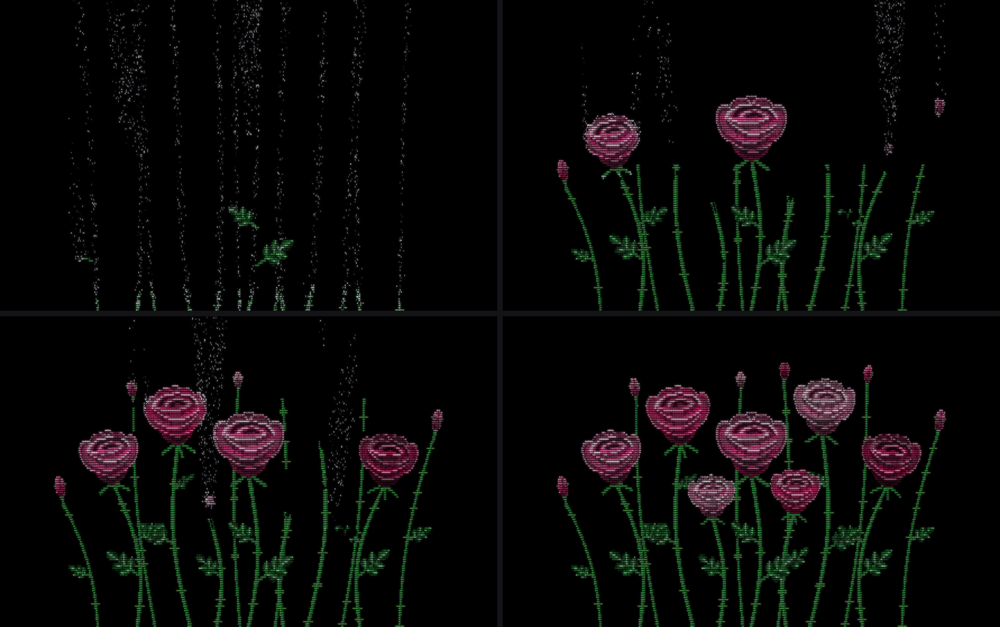

# ASCII Обои для macOS (C# / Avalonia)

Живые обои из цветных символов: розовые розы на чёрном фоне, которые вырастают
из медленного дождя белых символов.

**[⬇ Скачать .dmg](https://github.com/takamori-saigo/AsciiWallpaper/releases/latest)** · macOS 11+, Apple Silicon




<p align="center"><i>Как розы вырастают из падающих символов</i></p>



## Что внутри

- **Одни обои — «Розы под дождём»**. Идёт медленный дождь из белых символов, и каждый
  символ падает на своё место и становится частью розы. Стебли нарастают снизу вверх,
  потом бутон из середины, потом лепестки наружу. Розы вырастают по очереди, а дождь
  прекращается ровно тогда, когда вырос последний цветок. Другие обои в приложении поставить нельзя.
- **Настройки**: символы (плотность, своё слово, 0/1), размер символов и рисунка, скорость,
  сколько розы стоят, повторять ли цикл (розы мягко гаснут и вырастают заново), свечение, FPS.
- **Раздел «Розы»**: ширина голов, наклон в стороны, размер листьев (меняются сразу, без нового дождя),
  сила ветра (розы покачиваются, верхушки сильнее, порывами) и переливание (по лепесткам идут
  мягкие волны света с сиреневым отливом и редкими искорками).
- **На рабочем столе**: окно опускается под иконки (уровень desktop), не ловит клики,
  видно на всех рабочих столах (Spaces) и на всех мониторах.
- Иконка в **строке меню**: поставить или убрать обои, пауза, выход.
  Если открыты только обои, иконки в Доке нет.
- Настройки сохраняются в `~/Library/Application Support/AsciiWallpaper/`.

## Запуск из Rider / терминала

Нужен .NET 8 или 9 SDK.

```bash
cd AsciiWallpaper
dotnet run
```

Или откройте `AsciiWallpaper.csproj` в Rider и нажмите Run.

## Собрать настоящее приложение (.app)

```bash
chmod +x build-app.sh
./build-app.sh
open "dist/ASCII Обои.app"
```

Перетащите `.app` в «Программы».

## Установщик .dmg

```bash
chmod +x build-app.sh build-dmg.sh
./build-dmg.sh
```

Получится `dist/ASCII-Oboi.dmg` с оформленным окном установки: слева приложение, справа папка
«Программы», между ними стрелка и подсказка «Перетащите приложение в папку «Программы»».
При первой сборке macOS спросит, можно ли Терминалу управлять Finder (так раскладываются иконки
и ставится фон) — нажмите «Разрешить». Фон окна — `Assets/dmg/background.png` и `background@2x.png`.

Если отдаёте .dmg на другой Mac, при первом запуске macOS скажет «неизвестный разработчик»:
правый клик по приложению → «Открыть» → «Открыть» (или `xattr -cr "/Applications/ASCII Обои.app"`).

## Как это устроено
| Файл | Что делает |
|---|---|
| `Engine/Scenes.cs` | Сцена «Розы под дождём» — функция «есть ли что-то в точке (x, y), какого цвета и когда туда упадёт символ». |
| `Engine/AsciiEngine.cs` | Частицы и фазы: дождь и рост → покой → мягкое угасание → заново. |
| `Engine/GlyphAtlas.cs` | Все символы один раз рисуются в текстуру. Каждый символ на экране — спрайт из неё. |
| `Controls/AsciiCanvas.cs` | Рисует кадр через Skia `DrawAtlas`: тысячи символов за один вызов на GPU, плюс свечение. |
| `Platform/MacDesktop.cs` | Вызовы AppKit через objc_msgSend: `setLevel:` (desktop), `setIgnoresMouseEvents:`, `setCollectionBehavior:`. |
| `Windows/GalleryWindow.cs` | Окно с предпросмотром и настройками. |
| `Windows/WallpaperWindow.cs` | Окна-обои на каждом мониторе. |

### Где менять розы

Всё про рисунок и порядок роста — в `RoseGardenScene` (`Engine/Scenes.cs`):
`Roses` (где стоят цветы и бутоны, их оттенок и очередь роста), `AssembleSeconds` (сколько идёт дождь),
`FallSpeed` (скорость падения), `DetailScale` (чем меньше, тем мельче символы и больше деталей).
`Leaves` — листья из листочков на черешке, `Palettes` — оттенки роз, `Tilt` — насколько головы
наклонены в стороны, `Narrow` — ширина голов. Рисунок прижат к нижнему краю экрана (`AnchorBottom`).

## Если что-то не так

- **Окно обоев оказалось поверх других окон.** Нажмите в меню «Убрать» и затем «Поставить» ещё раз.
  Уровень окна выставляется в `MacDesktop.PinToDesktop`.
- **Подключили или отключили монитор.** Перезапустите обои из меню, тогда окна пересоздадутся.
- **Высокая нагрузка.** Поставьте 30 FPS, увеличьте размер символов или выключите свечение.
